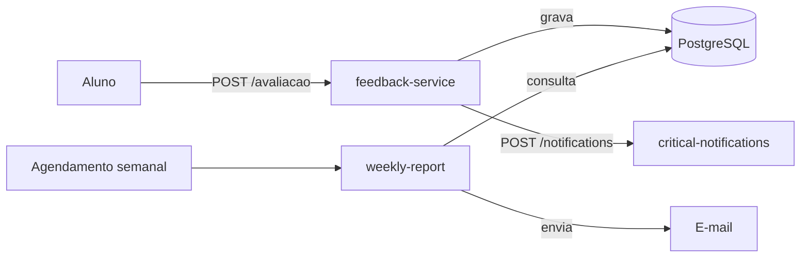

# FIAP Tech Challenge 4

Plataforma de avaliações de aulas. O sistema registra feedbacks, classifica a urgência das avaliações e envia um relatório semanal por e-mail.

## Arquitetura



Na AWS, os três módulos rodam em funções Lambda e o banco fica na Neon. O EventBridge Scheduler dispara o relatório e o Amazon SES envia o e-mail.

| Módulo | Responsabilidade |
| --- | --- |
| [feedback-service](feedback-service/README.md) | Recebe, classifica e grava avaliações. |
| [critical-notifications](critical-notifications/README.md) | Envia avisos de avaliações críticas por e-mail na AWS. |
| [weekly-report](weekly-report/README.md) | Gera e envia o relatório da semana anterior. |

O [guia de infraestrutura](infra/README.md) cobre o deploy automático a cada push na `main`, a configuração da Neon, os testes na AWS e a pausa do ambiente.

## Executar localmente com Docker

Abra o Docker Desktop e aguarde o Docker iniciar. Depois, abra um terminal na raiz do repositório, onde está o [`docker-compose.yml`](docker-compose.yml). O Compose já inclui as variáveis locais e os Dockerfiles fazem o build dos módulos. Você pode executar sem criar um arquivo `.env` ou configurar credenciais da AWS, da Neon ou do SES.

```sh
docker compose up --build -d --wait
docker compose ps
```

| Serviço | Endereço local | Uso |
| --- | --- | --- |
| `feedback-service` | `http://localhost:8080` | Receber avaliações com `POST /avaliacao`. |
| `critical-notifications` | `http://localhost:8081` | Registrar avisos críticos via `POST /notifications`. |
| `weekly-report` | `http://localhost:8082` | Invocar o handler pelo emulador local da Lambda. |
| Mailpit | `http://localhost:8025` | Conferir a captura local dos e-mails do relatório. |

Os serviços se comunicam pela rede do Compose. A ingestão e o relatório usam o mesmo PostgreSQL, com volume persistente. Na primeira inicialização, o banco cria a tabela e carrega avaliações de exemplo da semana anterior para a demonstração do relatório. As credenciais do Compose são para uso local.

### Variáveis locais

| Serviço | Variáveis | Valores locais |
| --- | --- | --- |
| PostgreSQL | `POSTGRES_DB`, `POSTGRES_USER`, `POSTGRES_PASSWORD` | Banco `feedbacks`, usuário e senha `feedback_service`. |
| Avaliações e relatório | `DB_URL`, `DB_USER`, `DB_PASSWORD` | `jdbc:postgresql://postgres:5432/feedbacks`, usuário e senha `feedback_service`. |
| Avaliações | `DB_DDL_AUTO`, `NOTIFICATIONS_URL` | `validate` e `http://critical-notifications:8081`. |
| Relatório | `EMAIL_PROVIDER`, `SMTP_HOST`, `SMTP_PORT` | `smtp` (padrão da aplicação), `mailpit` e `1025`. |
| Relatório | `NOTIFICATION_FROM`, `NOTIFICATION_RECIPIENTS` | `reports@example.com` e `admin@example.com`. O Mailpit captura o e-mail localmente. |

Os endereços `postgres`, `critical-notifications` e `mailpit` da tabela são nomes usados **entre os contêineres**. Para conectar a partir da sua máquina, use `127.0.0.1:55433` para PostgreSQL e `127.0.0.1:1025` para o SMTP do Mailpit. Os READMEs dos módulos descrevem a execução pelo Maven usando essas portas.

Se algum serviço falhar na inicialização, confira o status e os logs com `docker compose ps -a` e `docker compose logs --tail=100`.

## Testar com Postman

Com o Compose da raiz em execução, importe a [coleção FIAP Tech Challenge 4 — Local](postman/fiap-tc-4-local.postman_collection.json). Abra uma requisição e clique em **Send**, ou use **Run collection** para executar os três grupos:

- **Feedback service** testa o cadastro, os limites de urgência e a validação das avaliações.
- **Critical notifications** testa o registro de avisos críticos, o filtro de urgência e a validação do corpo.
- **Weekly report** gera o relatório da semana anterior. Abra o Mailpit em `http://localhost:8025` para conferir o e-mail capturado.

As URLs locais já estão preenchidas nas variáveis da coleção. Uma execução completa grava 10 avaliações no banco local e gera um e-mail no Mailpit. Para conferir o encaminhamento de uma avaliação crítica, rode `docker compose logs critical-notifications`.

Para o ambiente publicado, veja a [coleção Postman da AWS e sua configuração](infra/README.md#postman).

### Testar pelo terminal

Para testar a integração pelo PowerShell, envie uma avaliação crítica e confira o aviso:

```powershell
$body = @{ descricao = 'Video da aula indisponivel'; nota = 2 } | ConvertTo-Json
Invoke-RestMethod -Method Post -Uri 'http://localhost:8080/avaliacao' -ContentType 'application/json' -Body $body
docker compose logs critical-notifications
```

Para executar o relatório da semana anterior, faça uma invocação manual. O e-mail fica disponível no Mailpit, que captura a mensagem localmente.

```powershell
Invoke-RestMethod -Method Post -Uri 'http://localhost:8082/2015-03-31/functions/function/invocations' -ContentType 'application/json' -Body '{}'
```

O endpoint do relatório é fornecido pelo [emulador da imagem Java da AWS Lambda](https://docs.aws.amazon.com/lambda/latest/dg/java-image.html). Os pacotes de deploy da Lambda são gerados separadamente pelos builds Maven dos módulos.

## Parar o ambiente local

Para parar os serviços e preservar o banco:

```sh
docker compose down
```
