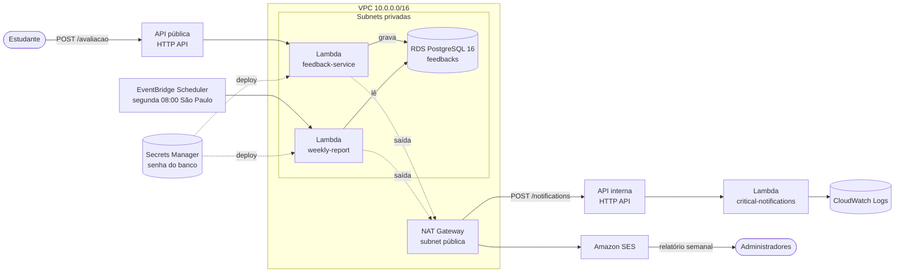

# Infraestrutura (AWS SAM)

Infraestrutura como código da plataforma de feedback, descrita em um único template AWS SAM (`template.yaml`, CloudFormation). Um deploy cria rede, banco, as três funções Lambda, as APIs, o agendamento do relatório, os logs e os papéis de acesso. Um `sam delete` remove tudo.

## Arquitetura



| Função | Gatilho | Responsabilidade |
| --- | --- | --- |
| `feedback-service` | API pública `POST /avaliacao` | Valida, classifica a urgência, grava no banco e encaminha avaliações críticas. |
| `critical-notifications` | API interna `POST /notifications` | Registra no log os avisos de urgência `CRITICAL`. |
| `weekly-report` | EventBridge Scheduler, segunda-feira 08:00 (`America/Sao_Paulo`) | Gera o relatório da semana anterior e o envia por e-mail via Amazon SES. |

Cada função tem pacote, papel IAM, grupo de logs e gatilho próprios.

## Recursos

| Grupo | Recursos | Observação |
| --- | --- | --- |
| Rede | VPC, 1 subnet pública, 2 subnets privadas em zonas diferentes, Internet Gateway, NAT Gateway, tabelas de rota | Banco e Lambdas com acesso ao banco ficam nas subnets privadas; o NAT dá a elas saída para a internet. |
| Security groups | `lambda-sg`, `db-sg` | O banco aceita a porta 5432 apenas de recursos no `lambda-sg`. Nenhuma regra de entrada vinda da internet. |
| Banco | RDS PostgreSQL 16.13, `db.t4g.micro`, 20 GB gp3 | Privado, criptografado em disco, SSL obrigatório (padrão do PostgreSQL 16 no RDS), 1 dia de backup. |
| Segredos | Segredo do RDS no Secrets Manager | Senha gerada e guardada pela AWS (`ManageMasterUserPassword`); não aparece no template nem no Git. |
| E-mail | Identidade do Amazon SES (`ReportSenderEmail`) | O SES envia um link de verificação no primeiro deploy. |
| Funções | 3 `AWS::Serverless::Function` (Java 21) | `feedback-service` e `critical-notifications` com 1024 MB e SnapStart; `weekly-report` com 512 MB e 60 s. |
| APIs | 2 HTTP APIs do API Gateway | Pública com limite de 20 req/s (pico 50); interna com 5 req/s (pico 10). Ambas com log de acesso. |
| Agendamento | EventBridge Scheduler (`ScheduleV2`) | Até 2 novas tentativas em caso de falha, dentro de 1 hora. |
| Logs | 6 grupos no CloudWatch Logs | Um por função, um por API e um para o PostgreSQL, com retenção configurável (padrão 14 dias). |
| CI/CD | Provedor OIDC do GitHub, papel de deploy, papel de execução do CloudFormation | Deploy pelo GitHub Actions sem chaves de acesso. |

## Segurança e governança de acesso

- **Rede:** o banco não tem endereço público e só aceita conexões do security group das Lambdas. A `critical-notifications` não acessa o banco e por isso fica fora da VPC.
- **Credenciais do banco:** geradas e guardadas pelo RDS no Secrets Manager. O template as injeta nas funções no momento do deploy (`{{resolve:secretsmanager:...}}`).
- **Criptografia:** dados e backups do RDS criptografados em disco; conexões com o banco via SSL.
- **Menor privilégio nas funções:** cada função tem seu próprio papel. Além de logs e acesso à VPC, apenas a `weekly-report` recebe uma permissão extra: `ses:SendEmail`, restrita ao remetente configurado (`ses:FromAddress`).
- **E-mail sem senha:** a `weekly-report` envia pela API do SES com o papel IAM da função; não há usuário nem senha SMTP.
- **Proteção das APIs:** limites de requisições por segundo nas duas APIs.
- **Dados pessoais nos logs:** os logs de acesso registram rota, status e latência, mas não o IP de quem chamou. Todos os logs expiram após o período de retenção.
- **Deploy pelo GitHub Actions (OIDC):** o GitHub recebe credenciais temporárias (até 1 hora), sem access key guardada. Só workflows do repositório configurado, na branch `main`, podem assumir o papel de deploy. Esse papel só consegue criar *change sets* desta stack e enviar pacotes ao bucket do SAM; quem cria os recursos é o papel de execução, que apenas o serviço CloudFormation pode assumir.

## Parâmetros

| Parâmetro | Padrão | Uso |
| --- | --- | --- |
| `Environment` | `dev` | Prefixo dos nomes dos recursos (`dev` ou `prod`). |
| `ReportSenderEmail` | obrigatório | Remetente do relatório semanal; precisa ser verificado no SES. |
| `AdminEmails` | obrigatório | Destinatários do relatório, separados por vírgula. |
| `LogRetentionInDays` | `14` | Retenção dos logs (1, 3, 7, 14 ou 30 dias). |
| `GitHubRepository` | `gabrielresan/fiap-tc-4` | Repositório autorizado a fazer deploy. |
| `GitHubDeployBranch` | `main` | Branch autorizada a fazer deploy. |
| `EnableGitHubOidc` | `true` | Controla a criação do provedor e dos papéis de OIDC. O workflow com chaves IAM usa `false`. |

Os e-mails não ficam no repositório: são informados no comando de deploy ou como variáveis do GitHub Actions.

## Pré-requisitos

- JDK 21, Docker (para os testes dos módulos), [AWS CLI v2](https://docs.aws.amazon.com/cli/latest/userguide/getting-started-install.html) e [AWS SAM CLI](https://docs.aws.amazon.com/serverless-application-model/latest/developerguide/install-sam-cli.html).
- Credenciais da AWS configuradas (`aws configure`) com permissão para criar os recursos acima. Teste com `aws sts get-caller-identity`.
- Um alerta de orçamento no AWS Budgets, para acompanhar o consumo de créditos.

## Deploy

Execute a partir da raiz do repositório.

1. Gere os pacotes das três funções:

   ```sh
   mvn -f feedback-service/pom.xml clean package
   mvn -f critical-notifications/pom.xml clean package
   mvn -f weekly-report/pom.xml clean package
   ```

   O template usa os artefatos `feedback-service/target/feedback-service-lambda.zip`, `critical-notifications/target/critical-notifications-lambda.zip` e `weekly-report/target/weekly-report-lambda.jar`.

2. Valide o template:

   ```sh
   cd infra
   sam validate --lint
   ```

3. Faça o deploy, informando os e-mails:

   ```sh
   sam deploy --parameter-overrides Environment=dev ReportSenderEmail=remetente@exemplo.com AdminEmails=admin@exemplo.com
   ```

   As demais opções (nome da stack `fiap-tc4-dev`, região `us-east-1`, bucket de artefatos e confirmação do *change set*) estão em `samconfig.toml`. O SAM envia os pacotes ao S3, mostra o que será criado e pede confirmação. A criação leva de 15 a 20 minutos, principalmente por causa do RDS.

4. Abra o e-mail de verificação enviado pela AWS ao `ReportSenderEmail` e clique no link. Enquanto a conta estiver no *sandbox* do SES, cada destinatário diferente do remetente também precisa ser verificado:

   ```sh
   aws sesv2 create-email-identity --email-identity admin@exemplo.com
   ```

5. Consulte os outputs (URL da API, nomes das funções, ARNs dos papéis):

   ```sh
   aws cloudformation describe-stacks --stack-name fiap-tc4-dev --query "Stacks[0].Outputs" --output table
   ```

No primeiro deploy, o SnapStart inicializa o `feedback-service` para gerar a imagem da função; nesse momento o Hibernate cria a tabela `feedbacks` no banco.

## Teste após o deploy

Enviar uma avaliação crítica (PowerShell), usando o output `FeedbackEndpoint`:

```powershell
$body = @{ descricao = 'Vídeo da aula não carrega'; nota = 2 } | ConvertTo-Json
Invoke-RestMethod -Method Post -Uri '<FeedbackEndpoint>' -ContentType 'application/json; charset=utf-8' -Body ([System.Text.Encoding]::UTF8.GetBytes($body))
```

Acompanhar o aviso crítico e as requisições:

```sh
aws logs tail /aws/lambda/dev-critical-notifications --since 10m
aws logs tail /fiap-tc4/dev/api/feedback --since 10m
```

Executar o relatório semanal sem esperar a segunda-feira:

```sh
aws lambda invoke --function-name dev-weekly-report response.json
```

O relatório considera a semana anterior; avaliações da semana corrente aparecem no relatório da próxima segunda-feira.

## Deploy automatizado (GitHub Actions)

### Com o usuário IAM do projeto AWS

O [workflow](../.github/workflows/deploy-lambda.yml) testa e empacota os três módulos e usa o SAM para criar ou atualizar a stack `fiap-tc4-dev`. Ele roda manualmente na `main`. A região padrão do workflow é Ohio (`us-east-2`).

1. Na conta e região do projeto, prepare um bucket S3 privado para os pacotes e um papel de serviço que o CloudFormation possa assumir. A política desse papel precisa permitir provisionar os recursos do template, incluindo a rede, o banco, as funções e seus papéis de execução. A configuração do workflow não cria esses dois recursos iniciais. Confira a [documentação de papéis de serviço do CloudFormation](https://docs.aws.amazon.com/AWSCloudFormation/latest/UserGuide/using-iam-servicerole.html).
2. Autorize o usuário da pipeline a acessar o prefixo `fiap-tc4-dev/` do bucket, criar e executar *change sets* da stack e consultar seu andamento, e usar `iam:PassRole` somente para o papel de execução do CloudFormation. A política de atualização de uma Lambda é insuficiente para criar a stack.
3. Em **Settings → Secrets and variables → Actions** no GitHub, cadastre:

   | Tipo | Nome | Valor |
   | --- | --- | --- |
   | Secret | `AWS_ACCESS_KEY_ID` | ID da chave do usuário da pipeline. |
   | Secret | `AWS_SECRET_ACCESS_KEY` | Chave secreta do usuário da pipeline. |
   | Secret | `REPORT_SENDER_EMAIL` | Remetente do relatório no SES. |
   | Secret | `ADMIN_EMAILS` | Destinatários do relatório, separados por vírgula e sem espaços. |
   | Variável | `AWS_CFN_EXECUTION_ROLE_ARN` | ARN do papel de serviço do CloudFormation. |
   | Variável | `AWS_SAM_ARTIFACT_BUCKET` | Nome do bucket de artefatos. |
   | Variável opcional | `AWS_REGION` | Região da stack, caso seja diferente de `us-east-2`. |

4. Com o workflow na `main`, use **Actions → Deploy dos três serviços na AWS → Run workflow**. Acompanhe a criação da stack na aba **Events** do CloudFormation. O template provisiona NAT Gateway e RDS. Confira no plano da conta se esses recursos estão disponíveis e cobertos pelos créditos antes de iniciar o deploy.
5. Verifique o remetente no SES e, se a conta estiver no sandbox, também os destinatários. Use o output `FeedbackEndpoint` e os passos de [teste após o deploy](#teste-após-o-deploy) para validar a avaliação crítica e o relatório.

### Com OIDC

O primeiro deploy, feito localmente, cria os papéis usados pelo GitHub Actions. A partir daí, o workflow precisa de:

- `permissions: id-token: write` e `contents: read`;
- `aws-actions/configure-aws-credentials` com `role-to-assume` igual ao output `GitHubDeployRoleArn` e `aws-region: us-east-1`;
- build dos três módulos com Maven;
- `sam deploy --no-confirm-changeset --role-arn <CloudFormationExecutionRoleArn> --parameter-overrides ...`, executado em `infra/`.

Apenas pushes na branch `main` do repositório configurado conseguem assumir o papel de deploy.

## Remoção

```sh
cd infra
sam delete
```

Remove a stack inteira, incluindo banco (sem snapshot final), logs e papéis. Os dados gravados são perdidos. O bucket de artefatos criado pelo SAM (`aws-sam-cli-managed-default`) é mantido para os próximos deploys.

## Custos

Com a stack no ar, os itens cobrados por hora são o NAT Gateway (cerca de US$ 0,05/h, mais o IP elástico) e o RDS `db.t4g.micro` (cerca de US$ 0,02/h), em torno de US$ 1,70 por dia na região `us-east-1`. Lambdas, APIs, Scheduler, SES e logs ficam próximos de zero no volume do projeto. Para economizar créditos, remova a stack quando não estiver em uso.

## Limitações e evoluções

- **Usuário do banco:** as duas funções usam o usuário principal do RDS. O ideal é um usuário com permissão de escrita para o `feedback-service` e outro somente leitura para o `weekly-report`.
- **Senha nas variáveis de ambiente:** a senha é injetada no deploy e fica visível na configuração da função para quem tem acesso ao console da Lambda. Ler o segredo do Secrets Manager em tempo de execução (ou usar autenticação IAM no RDS) eliminaria essa exposição e permitiria rotação automática.
- **API interna sem autenticação:** a rota `/notifications` é protegida apenas por limite de requisições. Autorização IAM na rota ou troca da chamada HTTP por uma fila/tópico (SNS/SQS) resolveriam.
- **Avisos críticos só em log:** a `critical-notifications` registra os avisos no CloudWatch. Um filtro de métrica sobre `critical_notification` com alarme e tópico SNS levaria o aviso por e-mail aos administradores.
- **Disponibilidade:** RDS e NAT em uma única zona, para reduzir custo.
- **SES em sandbox:** remetente e destinatários precisam ser verificados; envio limitado a 200 e-mails por dia.
